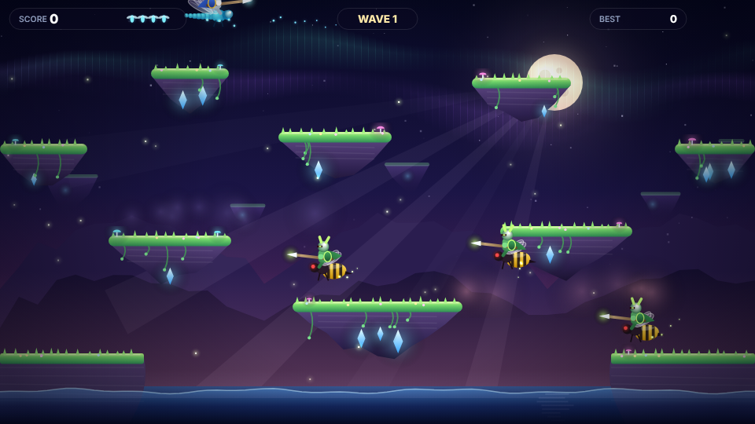

# Skylance

An original flap-and-joust arcade game for Android and the web. Ride a dragonfly, strike enemy riders from above (or blast them), grab their cocoons before they hatch, and fight your way through six realms.



## Features

- **6 realms, 60 levels, 6 bosses**: Moonlit Sea, Crystal Caverns, Storm Peaks, Ember Isles, Sunscorch Dunes and Cloud Citadel. Each has its own enemy insects, hazards and boss.
- **A unique island layout for every level**: hand-built layouts for levels 1, 4, 7 and 10 of the first four realms, generated layouts (always the same per level) for the rest. Later levels add moving islands.
- **Combat**: jousting (the higher lance wins), 5 upgradeable weapons, an energy meter, a boost dash, and 5 power-ups (Shield, Long Lance, Dash, Magnet, Frost).
- **Enemies**: flying riders in three strength tiers (green, orange, purple) on realm-specific insects, plus ground patrollers (Shell Guards and Spikers).
- **Progression**: stars per level, gems, a Hangar shop (mounts, trails, armor, weapons) and a permanent upgrade tree. Progress is saved on the device.
- **Endless mode** that cycles through every unlocked realm.

## Controls

| Action | Phone (landscape) | Keyboard |
|---|---|---|
| Steer | ◀ ▶ buttons | ← → or A / D |
| Flap | FLAP button (hold to auto-flap) | Space, ↑, W or Z |
| Fire | FIRE button (hold to auto-fire) | X, J or F |
| Boost | » button | Shift, C or K |
| Pause | ‖ button | Esc or P |
| Mute | Title screen | M |

## Project layout

```
www/index.html        The whole game: HTML, CSS and JavaScript in one file, with all art drawn in code
capacitor.config.json Capacitor app settings (app id com.skylance.game)
android/              Native Android project generated by Capacitor
package.json          Capacitor dependencies and build scripts
```

There is no bundler or build step for the game itself. Open `www/index.html` in a browser to play.

## Build the Android APK

Requirements: Node.js 18+, JDK 21, and the Android SDK (platform 35 and build-tools 35).

1. Install the dependencies:
   ```bash
   npm install
   ```
2. Point Gradle at your Android SDK by creating `android/local.properties`:
   ```
   sdk.dir=/path/to/android-sdk
   ```
3. Copy the web game into the Android project and build a debug APK:
   ```bash
   npm run apk
   ```
   The APK is written to `android/app/build/outputs/apk/debug/app-debug.apk`.

After editing `www/index.html`, run `npx cap sync android` (or `npm run apk` again) so the Android app picks up the change.

## Install on a phone

1. Copy the APK to the phone and open it.
2. Allow installs from that source when Android asks.
3. If Google Play Protect warns about an unknown app, choose **More details**, then **Install anyway**. Debug builds are signed with a temporary test key, which is why the warning appears.

Android 6.0 or newer is required.

Debug APKs built on different machines use different signing keys, so Android refuses to install one over the other. Uninstall the old build first (this erases saved progress). A permanent release key, needed for the Play Store, removes this problem.

## Licence

All rights reserved.
